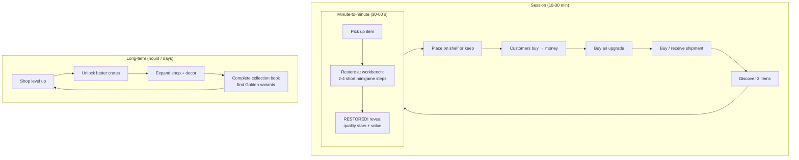
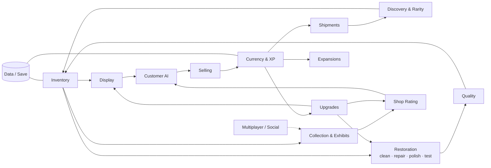
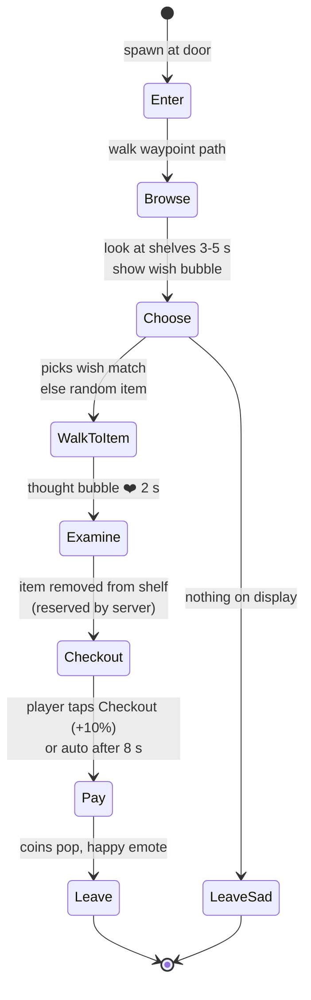

# 01: Game Design Document

Covers: game identity (A), gameplay systems (B), restoration interactions (C), multiplayer (E), UI/UX (J).
Numbers (prices, odds, costs) live in `02_Economy.md`. Code structure lives in `03_Architecture.md`.

---

## A. Game Overview

### A1. Identity
| | |
|---|---|
| **Title** | Dusty Finds: Restore & Sell |
| **Genre** | Restoration simulator + shop tycoon + collection |
| **Pitch** | *"Find it. Clean it. Fix it. Sell it. Grow your shop."* |
| **Platform** | Roblox: PC and mobile at launch (tablet supported; console later) |
| **Session length** | 10–30 minutes typical; one restoration = 30–60 seconds |
| **Server size** | 6 players (one shop plot each) |
| **Tone** | Cozy, colorful, satisfying. Cute but not babyish: warm wood, teal, coral, soft lighting |

### A2. Target audience
- **Core: ages 9–14.** They love discovery ("what's in the box?"), collecting, and decorating something that is *theirs*.
- **Secondary: 15+ and casual adults.** They enjoy relaxing tycoon progression, optimizing, and completing the collection book.
- Reading level: short words, icons everywhere, no paragraph tutorials.

### A3. Main gameplay loop



### A4. Core mechanics (MVP)
1. **Shipments**: buy crates with in-game money, plus a free delivery on a timer.
2. **Discovery**: open box → item reveal with rarity color and sound.
3. **Restoration**: each item has a *recipe* of 2–4 steps from 6 interaction types.
4. **Quality**: 1–3 stars from how well the steps went; affects value.
5. **Display & sell**: shelves hold items; NPC customers with wishes buy them.
6. **Keep & collect**: collection book tracks everything found; rare items can be exhibited for shop rating.
7. **Upgrades**: tools (faster/easier restoration), shelves, storage, sign, decor.
8. **Expansions**: unlock pre-built rooms (Back Room, Showroom).
9. **Shop level & rating**: level (from XP) unlocks crates; rating (from decor and exhibits) brings more customers.
10. **Social**: shops sit side by side on the server; visit, like, and get server-wide announcements for rare finds.

### A5. Player objectives
- **Short:** restore this item, fill this shelf, afford the next tool.
- **Medium:** reach shop level 5 (Flea Market crates), buy the Back Room, get 3 stars on your rating.
- **Long:** complete the collection book, find Golden variants, own the Showroom, hit 5-star rating.

### A6. Long-term progression
Three parallel tracks so there is always a next goal:

| Track | Driven by | Unlocks |
|---|---|---|
| **Shop Level** (1–20 in MVP) | XP from restorations | Crate tiers, upgrades, expansions |
| **Money** | Selling | Upgrades, decor, expansions |
| **Collection** | Discovering and keeping | Book completion rewards (badges, titles, a trophy decor item) |

### A7. Solo and multiplayer
- **Solo is the full game.** Everything can be done alone at full speed. Nothing requires another player.
- **Multiplayer is additive:** seeing other shops, visiting, liking, announcements for rare finds, and (Update 1) helping a friend restore. See §E.

### A8. What makes RE:STORE different
1. **Hands-on restoration instead of "click to fill a bar."** Every item is touched, wiped, assembled, and tested. Different items use different step combinations.
2. **Visible transformation.** The same item visibly goes from grimy to gleaming: the before/after is the reward.
3. **Discovery with knowledge.** Players learn which crates have which items and chase specific collection entries, not only bigger numbers.
4. **Your shop is your trophy room.** Rare items are displayed in *your* shop where friends can see them.
5. **Fair and kind.** No Robux loot boxes, no pay-to-win, no punishing timers.

---

## B. Gameplay Systems

Each system: **Purpose · Behavior · Depends on · Connects to.** Owners in brackets (see `04_Team_Roadmap_MVP.md`).



### B1. Shipment generation [Dev 1]
- **Purpose:** steady supply of items; the "what's inside?" hook.
- **Behavior:**
  - **Free Delivery:** every 3 minutes (real time while in game), a free Starter box with 1 item appears at the shop door. Only one free box can wait at a time (no stockpiling).
  - **Crates:** bought from the **Supply Board** (a screen at the shop) with money. Each crate tier has a price, item count (3), an item pool (a tier), and rarity odds. Tiers unlock by shop level.
  - When bought, the server rolls the contents immediately and stores them as **unopened** items. A box model appears at the door; opening it plays the reveal.
  - Opening is blocked if inventory is full (UI tells the player to sell or upgrade storage).
- **Depends on:** Economy (price), Data (level, inventory capacity), Config `Crates`, `Items`, `Rarities`.
- **Connects to:** Discovery (reveal), Inventory (adds items), Social (rare-find announcement).

### B2. Random object discovery [Dev 1 server · Dev 3 UI · Dev 2 VFX]
- **Purpose:** the excitement moment.
- **Behavior:** player presses `Open` on a box → client plays reveal (box shakes, lid pops, item spins up, rarity-colored burst) → item card shows name, rarity, condition, estimated restored value, **NEW!** tag if first time found → buttons `Restore` / `Store`.
- The roll already happened on the server; the client only animates the result it was told.
- **Connects to:** Collection (marks *found*), Inventory.

### B3. Object rarity and variants [Dev 1]
- **Rarity is fixed per item type** (Tin Robot is always Epic). Five tiers:

| Rarity | Color | Feel |
|---|---|---|
| Common | Gray `#9AA5B1` | everyday junk |
| Uncommon | Green `#2E9E5B` | nice find |
| Rare | Blue `#2F80ED` | exciting |
| Epic | Purple `#8B5CF6` | wow |
| Legendary | Gold `#E8A317` | server announcement |

- **Rolling:** roll rarity from the crate's odds, then pick a random item of that rarity from the crate's tier pool.
- **Variants (MVP: one type):** **Golden**, a 2% independent chance on any item. Gold material on polish-reveal, ×3 value, separate collection checkbox. Later variants (Update): color variants, "Signed", "Prototype".
- **Why fixed rarity:** much simpler to balance, display, and show in the collection book than rolling rarity per instance.

### B4. Object inventory [Dev 1 server · Dev 3 UI]
- **Purpose:** holds the player's items in every state.
- **Item states:** `Unopened` → `Dirty` (needs restoration) → `InProgress` (on a bench, step N) → `Restored` → (`Displayed` | `Exhibited` | sold and removed).
- **Capacity:** starts at 8 (counts everything except displayed and exhibited items). Storage upgrades raise it.
- **UI:** grid of item cards with rarity border, state icon, stars, and value. Filters: All / Needs Restoring / Restored. Tapping an item shows actions valid for its state (Restore, Display, Exhibit, Quick Sell).
- **Connects to:** almost everything; Data saves it.

### B5. Cleaning mechanics [Dev 2]: see §C (Wipe, Scrape)
### B6. Repair mechanics [Dev 2]: see §C (Reassemble, Replace)
### B7. Polishing mechanics [Dev 2]: see §C (Polish, Test)

### B8. Restoration quality [Dev 2 · Dev 1 validation]
- **Purpose:** reward care without punishing kids.
- **Behavior:** each step returns a score 0–100. Wipe, Scrape, and Polish give 100 when completed (they're about satisfaction, not skill). Skill steps can lose points: Reassemble −10 per wrong placement (min 50), Test by timing zone (green 100 / yellow 75 / red = try again, no penalty for the first miss).
- Final quality = average of step scores + tool bonus (Toolkit/Polisher levels, up to +10), capped at 100.
  - **≥ 90 → ★★★ Mint** (×1.3 value) · **≥ 70 → ★★ Good** (×1.0) · **else ★ Fair** (×0.8)
- Most careful players get 3 stars; the stars mainly teach "do it well" and reward upgrades.
- **Server checks:** step order, minimum step durations, scores clamped 0–100 (see `03_Architecture.md` §7).

### B9. Customer AI [Dev 3]
- **Purpose:** turns displayed items into money with personality.
- **Behavior (simple state machine, waypoints, no pathfinding):**



- **Spawning:** one customer every *interval* seconds while the shop has ≥1 displayed item. Interval depends on shop rating and sign upgrade (30 s down to ~12 s; exact formula in `02_Economy.md` §5). Max 3 customers in a shop at once (5 after Showroom).
- **Wishes:** each customer has 1 category wish (Toys, Electronics, Kitchen, Music, Decor). 70% of the time the wish is chosen from categories currently on display, so wishes are usually satisfiable. Wish match = +25% price.
- **Customer types (MVP: 4 looks, same behavior):** Kid, Grandpa, Collector, Teen. Collectors prefer Rare+ items.
- **Server spawns and moves NPCs** (Humanoid:MoveTo along a plot's waypoint parts). Keep NPC count low: 6 plots × 3 = 18 max per server.
- **Connects to:** Display (reads shelves), Selling, Rating.

### B10. Selling system [Dev 1 server · Dev 3 UI]
Two ways to sell, both server-calculated:
1. **Customers (main way):** price = `baseValue × qualityMult × variantMult × (1.25 if wish match) + tip`. Tip chance rises with rating.
2. **Quick Sell (at the counter):** instant, 70% of the base price, no wish bonus. For full inventory or players who just want to keep restoring.

Selling grants money (and XP is earned on restoration, not on sale, so keeping items isn't punished).

### B11. Currency and rewards [Dev 1]
- **One currency: Cash ($).** Earned only from selling (plus small one-time rewards). No second premium currency.
- **XP** from restoring (more for rarer items). Levels unlock content.
- **Rewards:** first-time discovery bonus (+$10 to +$200 by rarity), level-up rewards (cash + sometimes a decor item), collection page completion (badge + trophy decor).

### B12. Shop upgrades [Dev 1 logic · Dev 3 visuals]
- **Purpose:** frequent, visible milestones.
- **Types:** Tools (Cleaning Brush, Repair Toolkit, Polisher) make steps faster or more forgiving; Display Shelves (+3 slots per level); Storage Racks (+inventory); Shop Sign (more customers); Decor (fixed decor slots: plants, rug, lamps, posters) gives rating points.
- **Upgrade menu** (hammer button) shows cost, level requirement, and effect ("Scrub 25% faster").
- **Placement:** fixed slots. Buying Shelf L2 makes the next pre-placed shelf appear. **No free-placement building in MVP.**

### B13. Shop expansion [Dev 3 models · Dev 1 logic]
- Each plot is built in Studio at its **largest** size; expansion rooms are stored hidden in `ServerStorage` and cloned into the plot when bought (classic tycoon technique).
- **MVP expansions:** **Back Room** (2nd workbench, more storage), **Showroom** (premium display slots, 3 exhibit pedestals, customer cap +2).
- Walls between rooms are "Coming soon" boards until bought.

### B14. Collectibles and display system [Dev 3 · Dev 1]
- **Display slots** (shelves): items here are for sale.
- **Exhibit pedestals**: items here are **kept**, not for sale. They give rating points (Rare 2, Epic 4, Legendary 8, Golden ×2), get a spotlight, a glowing nameplate, and visitors can inspect them.
- **Collection book**: pages per tier, entries per item: silhouette (not found) → found → restored best stars → Golden found. Page completion rewards.

### B15. Multiplayer interactions [Dev 3]: see §E
### B16. Saving player progress [Dev 1]
- **ProfileStore** (session-locked DataStore wrapper) saves the profile: money, XP, inventory, displays, exhibits, upgrades, expansions, collection, stats, settings, timers.
- Autosaves periodically; saves on leave and server shutdown.
- Plot layout is **not** saved as geometry; it's rebuilt from saved upgrade and expansion levels.
- Details: `03_Architecture.md` §9.

---

## C. Restoration Interaction Design

This is the heart of the game. Goal: **short, tactile, varied, but cheap to build.**

### C1. Key simplification: 4 code modules → 6 interactions
Instead of a custom minigame per item, we build **4 reusable minigame modules**. Each item lists a **recipe** of steps; each step names an interaction type plus a few settings. Variety comes from **data and models**, not new code.

| Interaction | Module | Player action | Feels like |
|---|---|---|---|
| **Wipe** (dirt) | `SpotClear` | Drag over dirt patches until they fade | Satisfying swipe |
| **Scrape** (rust) | `SpotClear` (mode: back-and-forth) | Drag back and forth on rust; each reversal scrapes a layer | Scratch-off ticket |
| **Reassemble** (broken parts) | `Socket` | Tap a loose part, then tap its glowing socket (or drag) | Jigsaw snap |
| **Replace** (missing parts) | `Socket` (parts come from a tray) | Pick the right part out of 3 options and place it | Simple puzzle |
| **Polish** (worn surfaces) | `Rub` | Rub in any pattern on dull surfaces; shine meter fills | Buffing to a gleam |
| **Test** (does it work?) | `Timing` | Stop a moving needle in the green zone (wind key, tune radio, press button) | One-tap skill check |

**Example recipes**
| Item | Recipe |
|---|---|
| Rubber Duck (Common) | Wipe → Polish |
| Toy Car (Common) | Wipe → Reassemble (wheels) → Polish |
| Alarm Clock (Uncommon) | Scrape → Reassemble (bell) → Test (wind) |
| Cassette Player (Uncommon) | Wipe → Replace (missing button) → Test (play) |
| Tin Robot (Epic) | Wipe → Scrape → Reassemble (arm) → Polish → Test (wind) |

Rule of thumb: Common 2 steps, Uncommon/Rare 3, Epic/Legendary 4–5. Rarer = longer, but each step stays 5–15 s.

### C2. How restoration works in Roblox Studio

**Bench view (big beginner win):** when the player starts restoring, the client
1. clones the item model (from `ReplicatedStorage/Assets/Items/<ItemId>`) onto the bench's `ItemAnchor`,
2. sets the camera to `Scriptable` at the bench's `CameraPoint` part (fixed angle, no camera fighting),
3. freezes the character (client disables controls), and shows the restoration HUD (step name, hint, progress, Exit).

All interactions are then **pointer raycasts** from the camera to parts of the item model. Mouse and touch use the same code:

```lua
-- Pseudocode: shared input for all minigames (client)
UserInputService.InputChanged:Connect(function(input)
    if input.UserInputType == Enum.UserInputType.MouseMovement
       or input.UserInputType == Enum.UserInputType.Touch then
        local ray = camera:ViewportPointToRay(input.Position.X, input.Position.Y)
        local hit = workspace:Raycast(ray.Origin, ray.Direction * 50, params) -- params: only the item model
        if hit and isPointerDown then currentMinigame:OnDrag(hit) end
    end
end)
```

**Item Model Contract** (every item model must follow it; owned by Dev 2):
```
<ItemId> (Model, PrimaryPart = Base)
├── Base                 -- main body
├── DirtSpots/           -- Parts, each with a dirt Decal; code fades Decal.Transparency
├── RustSpots/           -- Parts with rust texture; NumberValue "Layers" optional
├── Sockets/             -- invisible Parts named after the part that fits: "LeftArm", "Wheel"
├── LooseParts/          -- Parts/Models named to match sockets (start placed on the tray)
├── PolishSurfaces/      -- Parts whose Reflectance/Material changes as shine increases
└── TestPoint            -- Part where the Test UI appears (key, button, dial)
```
Only folders used by that item's recipe are required.

**Final MVP part names** (decided by Dev 1, Ace; not open for debate in the MVP). One name = one socket in `Sockets/` + one loose part in `LooseParts/`, spelled exactly like this. Config: `Shared/Config/Items.luau` (`parts = { ... }`).

| Item | Step | Part name | Item | Step | Part name |
|---|---|---|---|---|---|
| ToyCar | Reassemble | `Wheel` | PocketWatch | Replace | `Gear` |
| DeskLamp | Replace | `Bulb` | TubeRadio | Replace | `Tube` |
| AlarmClock | Reassemble | `Bell` | RotaryPhone | Reassemble | `Handset` |
| CassettePlayer | Replace | `Button` | Marionette | Reassemble | `Leg` |
| MusicBox | Reassemble | `Dancer` | ShipInBottle | Reassemble | `Mast` |
| RetroCamera | Replace | `Lens` | Jukebox | Replace | `Record` |
| CopperKettle | Reassemble | `Lid` | Gramophone | Replace | `Horn` |
| TinRobot | Reassemble | `LeftArm` | | | |

### C3. Each interaction in detail

**Wipe / Scrape (`SpotClear`)**
- Each spot has `health` (Wipe: 1.0; Scrape: 1.0 split into 3 layers).
- Wipe: every frame the pointer is down over a spot, reduce health by `dt × speed` (speed from Cleaning Brush level). Set Decal transparency to `1 - health`. Spawn bubble particles at the hit point.
- Scrape: count **direction reversals** of the pointer while over a rust spot; each reversal removes a chunk. Orange flake particles and a scratch sound.
- **Variety for free:** each item instance enables a **random 60–80% of its spots**, so it never looks identical twice.
- Step complete when all active spots are cleared. Progress = cleared / total.

**Reassemble / Replace (`Socket`)**
- Loose parts sit on a tray. **Tap part → it highlights; tap glowing socket → it tweens into place** with a click sound. Drag-and-drop is optional polish; tap-tap is easier on mobile and easier to code.
- Wrong socket → part shakes, returns to tray, −10 score.
- Replace: tray shows the needed part plus 2 decoys (from a small shared decoy pool). Toolkit upgrade L2+ highlights the correct one.
- Complete when every socket is filled.

**Polish (`Rub`)**
- Accumulate pointer movement distance while down over any `PolishSurfaces` part.
- Shine 0→100%: lerp `Reflectance` 0→0.3 and swap material at 100% (e.g. SmoothPlastic → Metal for chrome items), add sparkle particles at milestones (25/50/75/100%).
- Polisher upgrade raises distance-to-shine ratio.

**Test (`Timing`)**
- A ring/needle UI over `TestPoint`. Needle sweeps; player taps to stop. Green zone size depends on rarity (easier for Common).
- Success plays the item's "working" moment: robot walks a few studs, radio plays a jingle, clock rings. **This is the best payoff in the game; give it sound and animation.**

**Finish (shared):** RESTORED! banner, before/after card (thumbnail of dirty vs restored state), stars, value, `Display` / `Exhibit` / `Store` buttons.

### C4. Keeping it beginner-friendly
- Build **one** minigame end-to-end first (Wipe) on a single test item in an empty baseplate before touching shipments or UI.
- Every minigame module has the same interface:
  ```lua
  Minigame.new(model, stepConfig, onProgress, onComplete) -> object
  object:OnPointerDown(hit) / :OnDrag(hit, delta) / :OnPointerUp() / :Destroy()
  ```
- Dirt and rust visuals are **decals on spot parts**: no mesh editing, no shaders, no EditableImage.
- No physics. Parts are anchored; tweens move them.
- Test with a phone in Device Emulator from day one.

### C5. What we will NOT do (too hard for MVP)
Painting with brushes on textures, real mesh deformation, physics-based assembly, free-rotating the item in 3D (fixed camera angle per bench instead; a "rotate 90°" button is a possible later addition).

---

## E. Multiplayer Design

### E1. Server model
- **6 plots per server**, in a small town of three streets (Market Street, Antique Row, Workshop Lane) joined by a west avenue, two shops facing each other on each street (decision 2026-11, see docs/06 D-Map). Each player is assigned a free plot on join; their shop sign shows their name.
- No private instances or reserved servers in MVP. Visiting = walking to the other street, or the "Visit" list in the HUD that teleports you to a plot's door within the same server. **The Visit list becomes necessary now that shops are 100-300 studs apart (ShopSocialService is still an empty skeleton).**

### E2. MVP social features
| Feature | How it works | Why |
|---|---|---|
| **Visit shops** | Walk in, look around, inspect exhibits (nameplate + rarity) | Show-off loop |
| **Like a shop** | Prompt at a shop's counter; 1 like per shop per visitor per day; owner gets +1 like and a tiny cash reward ($25, max 10 rewarded likes/day) | Positive social feedback, capped against farming |
| **Rare-find announcements** | Epic and Legendary discoveries post a system chat message server-wide: *"Sean found a LEGENDARY Golden Gramophone!"* | Shared excitement; draws visitors |
| **Invite friends** | HUD button → `SocialService:PromptGameInvite` | Growth |
| **Safe by design** | Visitors **cannot interact** with anything in your shop (prompts only work for the owner). No griefing possible. | Kids' safety, no moderation burden |

### E3. Update 1: Helping friends
- Owner toggles **"Let friends help."** A friend can use the owner's **Back Room workbench** to restore the owner's items (items stay owned by the owner).
- Rewards: owner gets the item normally; helper gets XP + a **Helper Bonus** of 20% of the item's value, **created by the game, not taken from the owner**.
- Why later: needs permission checks, cross-player item access, and bench ownership logic, which are much easier once single-player restoration is solid.

### E4. Why solo players aren't disadvantaged
- Income per workbench is identical solo or co-op. Co-op adds a second pair of hands, not a multiplier.
- Helper Bonus is extra money for the helper, not a discount for groups.
- No content, crate, or item requires a group.
- Social rewards (likes) are tiny and capped.

### E5. Not in the first release
Trading (scams and duplication exploits, plus Roblox trading-policy complexity), shared/co-owned shops, cross-server visiting, global marketplace, PvP anything.

---

## J. UI/UX Design

### J1. Style
- Rounded, chunky shapes; font **Fredoka** for headings, **Nunito** or **Builder Sans** for body (both available in Studio).
- Palette: Teal `#0E7C7B` (primary), Coral `#F2784B` (accent/CTA), Cream `#FFF8EE` (panels), Ink `#1F2D3A` (text), plus the rarity colors.
- Icons over words. Every button ≥ 44 px tall on mobile. Max 2 primary buttons per panel.
- Use `UIScale` + `UIAspectRatioConstraint`; anchor HUD to corners; test on a small phone layout.

### J2. Screen layout

```
┌──────────────────────────────────────────────────────────────┐
│ [$ 1,250] [★★★☆☆ Rating]                         [👥] [⚙]   │
│ [Lv 4 ▓▓▓▓░░░░░░ XP]                                          │
│ [🎒]            [notification banner]                         │
│ [🔨]              (3D world / bench view)                     │
│ [📖]                                                          │
│ [📦]                                                          │
│                     [ hint / prompt area ]                    │
│ (thumbstick)                                  (jump button)  │
└──────────────────────────────────────────────────────────────┘
```

### J3. Interfaces

| Interface | Layout | Function |
|---|---|---|
| **Main HUD** | Top-left money + rating pills; a row of buttons under the XP bar (Inventory 🎒, Upgrades 🔨, Collection 📖, Supply 📦); top-right Settings ⚙ and Visit 👥; level/XP bar under the pills (bottom-left is the mobile thumbstick, bottom-right the jump button) | Always visible, minimal |
| **Money display** | Teal pill, coin icon, number animates up/down, `+$480` floats on gain | Instant feedback |
| **Inventory** | Center modal, 4-column grid of cards (rarity border, state icon, stars, value); filter tabs; capacity `8/16` | Choose what to restore, display, or sell |
| **Shipment notification** | Coral banner slides from top: "📦 Free delivery arrived!" / "Crate delivered!", auto-hides after 4 s; box at the door has a bobbing ❓ marker | Draws player to the door |
| **Discovery card** | Center card: rarity banner, item name, 5-dot rarity bar, condition, est. value, NEW! tag; `Restore` / `Store` | The reveal |
| **Restoration HUD** | Top-center hint ("Drag to wipe the dirt!"), step chips (●●○○), right-side progress bar, Exit (✕) top-right | Clear, uncluttered during minigames |
| **Customer requests** | World-space BillboardGui thought bubbles above NPCs with a category icon; Checkout prompt at counter with mood face | Readable at a glance |
| **Upgrade menu** | Modal with tabs (Tools / Shop / Decor / Expansions); cards show icon, level dots, effect text, cost, lock reason ("Reach Lv 5") | Clear next goals; "affordable" glow |
| **Supply Board** | Crate cards with price, item count, level lock, and an **odds table** (rarity %) | Transparent odds, even for in-game cash |
| **Collection book** | Book-style modal, page per tier, 4×3 grid of entries: silhouette → found → stars → golden badge; page progress `7/12` and reward preview | Long-term goal |
| **Settings** | Music / SFX toggles, Reduce effects (low-end devices), Camera shake off, Show announcements on/off | Accessibility + performance |

### J4. UX rules
- **First 2 minutes are scripted:** free box waiting at the door → arrow → open → restore a Rubber Duck (Wipe → Polish) → put on shelf → a customer buys it → +$ → "Buy your first upgrade!" arrow. No text walls.
- Every action gets feedback within 0.1 s (sound, tween, or particle) even if the server confirm comes later.
- Never stack more than one modal. Opening a menu closes others.
- If an action fails on the server, show a friendly toast ("Inventory full! Sell or upgrade storage.").
