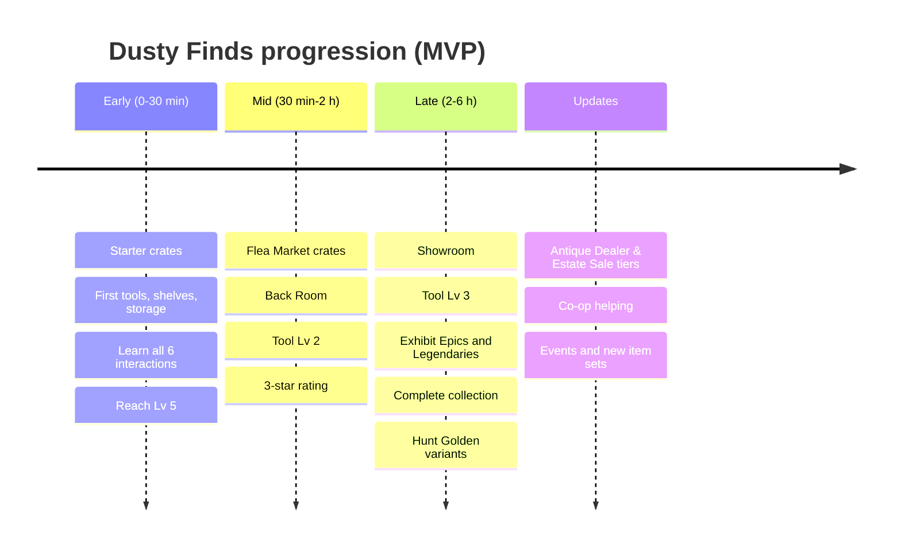

# 02: Progression & Economy

All numbers here are **starting values**. They go into `ReplicatedStorage/Shared/Config/*` and get tuned
from playtests. Never hardcode them in services.

Pacing targets (checked with a simple simulation, see §9):

| Milestone | Target time (new player) | Simulated median |
|---|---|---|
| First sale | < 3 min | ~2 min |
| First upgrade | < 5 min | ~1–4 min |
| Lv 5: Flea Market crates | ~25 min | 23 min |
| Back Room expansion | ~1 hour | 58 min |
| Lv 10 | ~1.5 hours | 83 min |
| Lv 15 (MVP level cap) | ~3 hours | 187 min |
| Showroom | ~4 hours | 231 min |
| Collection book (non-Golden) complete | 4–6 hours | depends on luck (Legendary 1%) |

MVP gives roughly **4–6 hours** of progression plus Golden-variant hunting. Updates add crate tiers (§8).

---

## 1. Starting state
| | |
|---|---|
| Starting cash | **$100** |
| Starting inventory capacity | 8 |
| Display slots | 3 |
| Exhibit pedestals | 1 |
| Workbenches | 1 |
| Free Delivery | 1 Tier-1 item every **3 minutes** (max 1 waiting) |
| First box | A guaranteed **Rubber Duck** waits at the door (tutorial) |

---

## 2. Rarity

| Rarity | Index | XP per restore | First-find bonus (Tier 1 / Tier 2) | Exhibit rating points |
|---|---|---|---|---|
| Common | 1 | 10 | $10 / $50 | 0 |
| Uncommon | 2 | 20 | $25 / $125 | 1 |
| Rare | 3 | 40 | $60 / $300 | 2 |
| Epic | 4 | 80 | $120 / $600 | 4 |
| Legendary | 5 | 160 | $300 / $1,500 | 8 |

- Tier 2 items give **×2 XP**.
- **Golden variant:** 2% chance on any roll, ×3 value, ×2 exhibit points, separate collection entry.

---

## 3. Crates (shipments)

| Crate | Price | Unlock | Items | C / U / R / E / L odds | Avg base value per item |
|---|---|---|---|---|---|
| Free Delivery | free | Lv 1 | 1 | 75 / 20 / 5 / 0 / 0 | ~$22 |
| **Starter Crate** | $50 | Lv 1 | 3 | 60 / 25 / 10 / 4 / 1 | $37.50 |
| **Flea Market Crate** | $300 | Lv 5 | 3 | 55 / 27 / 12 / 5 / 1 | $204 |
| Antique Dealer Crate *(Update 1)* | $1,800 | Lv 12 | 3 | 50 / 28 / 14 / 6 / 2 | ~$1,200 |
| Estate Sale Crate *(Update 2)* | $9,000 | Lv 18 | 3 | 45 / 30 / 15 / 7 / 3 | ~$6,000 |

**Odds are shown on the Supply Board** for every crate (good practice, and required by Roblox if crates were ever
bought with Robux-purchased currency; see `05_Monetization_QA.md` §K3).

A crate's expected sell value is about **2–3× its price** after restoration. That keeps crates feeling rewarding;
the real limit on income is **time spent restoring and customer flow**, not crate cost.

---

## 4. Item list (MVP: 20 items, 5 categories)

Categories: **Toys · Kitchen · Decor · Music · Electronics** (used by customer wishes).

### Tier 1: Starter (12 items)
| Item ID | Name | Rarity | Category | Base value | Recipe |
|---|---|---|---|---|---|
| RubberDuck | Rubber Duck | Common | Toys | $12 | Wipe → Polish |
| Teacup | Floral Teacup | Common | Kitchen | $14 | Wipe → Polish |
| ToyCar | Toy Race Car | Common | Toys | $16 | Wipe → Reassemble (wheels) → Polish |
| DeskLamp | Desk Lamp | Common | Decor | $18 | Wipe → Replace (bulb) → Test (switch) |
| AlarmClock | Alarm Clock | Uncommon | Electronics | $32 | Scrape → Reassemble (bell) → Test (wind) |
| SnowGlobe | Snow Globe | Uncommon | Decor | $35 | Wipe → Polish → Test (shake) |
| CassettePlayer | Cassette Player | Uncommon | Music | $38 | Wipe → Replace (button) → Test (play) |
| MusicBox | Music Box | Rare | Music | $80 | Scrape → Reassemble (dancer) → Polish → Test (wind) |
| RetroCamera | Retro Camera | Rare | Electronics | $85 | Wipe → Replace (lens) → Polish → Test (flash) |
| CopperKettle | Copper Kettle | Epic | Kitchen | $170 | Scrape → Reassemble (lid) → Polish → Test (whistle) |
| TinRobot | Vintage Tin Robot | Epic | Toys | $180 | Wipe → Scrape → Reassemble (arm) → Polish → Test (wind) |
| Gramophone | Antique Gramophone | Legendary | Music | $450 | Wipe → Scrape → Replace (horn) → Polish → Test (play) |

### Tier 2: Flea Market (8 items)
| Item ID | Name | Rarity | Category | Base value | Recipe |
|---|---|---|---|---|---|
| VinylRecord | Vinyl Record | Common | Music | $70 | Wipe → Polish |
| EnamelMug | Enamel Camp Mug | Common | Kitchen | $75 | Scrape → Polish |
| RotaryPhone | Rotary Phone | Uncommon | Electronics | $170 | Wipe → Reassemble (handset) → Test (ring) |
| Marionette | Wooden Marionette | Uncommon | Toys | $180 | Wipe → Reassemble (limbs) → Polish |
| PocketWatch | Pocket Watch | Rare | Decor | $400 | Scrape → Replace (gear) → Polish → Test (tick) |
| TubeRadio | Tube Radio | Rare | Electronics | $420 | Wipe → Replace (tube) → Polish → Test (tune) |
| ShipInBottle | Ship in a Bottle | Epic | Decor | $900 | Wipe → Reassemble (mast) → Polish → Test (light) |
| Jukebox | Mini Jukebox | Legendary | Music | $2,250 | Wipe → Scrape → Replace (record) → Polish → Test (play) |

**Art budget tip:** 20 items × simple part-built models is realistic. Build Common items first (2-step recipes)
so the game is playable early; Epic/Legendary models can be prettier and come last.

---

## 5. Selling prices

```
price = baseValue × qualityMult × variantMult × wishMult + tip
```
| Factor | Values |
|---|---|
| qualityMult | ★ 0.8 · ★★ 1.0 · ★★★ 1.3 |
| variantMult | Normal 1 · Golden 3 |
| wishMult | 1.25 if the item's category matches the customer's wish, else 1 |
| tip | chance = 5% + 5% × rating stars; amount = 10–25% of price |
| Checkout bonus | +10% if the owner taps Checkout before the 8 s auto-checkout |
| **Quick Sell** | 70% of `baseValue × qualityMult × variantMult` (no wish, no tip) |

Customer spawn interval: **30 s × 0.9^(Shop Sign level)**, then by rating: 1★ ×1.0 · 2★ ×0.9 · 3★ ×0.8 · 4★ ×0.7 · 5★ ×0.6 (minimum 10 s).
Max simultaneous customers: 3 (Showroom: 5).

---

## 6. Upgrades, decor, expansions

### Tools
| Upgrade | Lv 1 | Lv 2 | Lv 3 | Effect per level |
|---|---|---|---|---|
| Cleaning Brush | $150 (Lv 1) | $1,500 (Lv 5) | $8,000 (Lv 10) | Wipe/Scrape +25% speed |
| Repair Toolkit | $250 (Lv 2) | $2,000 (Lv 6) | $9,000 (Lv 11) | L1 hover highlight · L2 correct part glows in Replace · L3 +5 quality |
| Polisher | $200 (Lv 2) | $1,800 (Lv 5) | $8,500 (Lv 10) | Polish +30% speed; L3 +5 quality |

### Shop
| Upgrade | Lv 1 | Lv 2 | Lv 3 | Effect |
|---|---|---|---|---|
| Display Shelves | $120 (Lv 1) | $900 (Lv 3) | $4,000 (Lv 7) | +3 display slots each (3 → 12) |
| Storage Racks | $100 (Lv 1) | $1,000 (Lv 4) | $5,000 (Lv 8) | Capacity 8 → 16 → 24 → 40 |
| Shop Sign | $300 (Lv 2) | $2,500 (Lv 6) | $12,000 (Lv 12) | −10% customer interval each |

### Decor (one-time, fixed slots, rating points)
| Decor | Cost | Points |
|---|---|---|
| Potted Plants (×2) | $80 each | 1 each |
| Rug | $150 | 2 |
| Wall Posters | $200 | 2 |
| Pendant Lamps | $400 | 3 |
| Neon "RE:STORE" Sign | $1,500 | 5 |
| Fish Tank (Back Room) | $3,000 | 6 |
| Fountain (Showroom) | $10,000 | 10 |

### Expansions
| Expansion | Cost | Unlock | Adds | Rating pts |
|---|---|---|---|---|
| **Back Room** | $2,500 | Lv 4 | 2nd workbench (used for co-op in Update 1; solo players can use either bench), storage decor slot, Fish Tank slot | 3 |
| **Showroom** | $20,000 | Lv 10 | +6 premium display slots, +3 exhibit pedestals, Fountain slot, customer cap 5 | 8 |

### Shop rating
Points = decor + expansions + exhibits. Stars: **1★ 0 · 2★ 8 · 3★ 20 · 4★ 40 · 5★ 65.**

---

## 7. XP and levels
- XP to go from level *L* to *L+1* = **round(40 × L^1.6)**. Cumulative: Lv 5 ≈ 760 XP · Lv 10 ≈ 5,350 · Lv 15 ≈ 15,000.
- **Level-up reward:** $50 × new level, plus unlock popups ("Flea Market crates unlocked!").
- **MVP level cap: 15** (raised with each content update).

| Level | Unlock |
|---|---|
| 1 | Starter Crate, Brush, Shelves, Storage, basic decor |
| 2 | Toolkit, Polisher, Shop Sign |
| 4 | Back Room |
| 5 | **Flea Market Crate**, Brush 2, Polisher 2 |
| 10 | **Showroom**, Brush 3, Polisher 3 |
| 12 | Sign 3 (Antique Dealer crate in Update 1) |
| 15 | Cap: "Master Restorer" title |

---

## 8. Early, mid, late game



## 9. Balancing method (avoid grinding)
1. **Keep the economy in one spreadsheet** (items, crates, upgrades) that mirrors the Config files.
2. **Rule of thumb:** the next meaningful purchase should always be **≤ 10 minutes** away early, **≤ 20 minutes** mid-game. If a gap is longer, add a cheaper intermediate purchase (decor) rather than lowering everything.
3. **Expected value check:** crate EV after restoration should stay 2–3× price. Under 1.5× feels bad; over 4× makes crates trivial.
4. **Income is time-bound, not crate-bound:** restoration speed (~1.4 items/min early) and customer flow cap income. Tools raise speed; Sign and rating raise flow. These are the real progression levers.
5. **Simulation used for this doc** (Python, 200 runs, solo player, greedy buying, ~1.4 items/min base, +15% per tool level): results in the table at the top. Re-run it when you change numbers (Claude Code can maintain `tools/econ_sim.py`).
6. **Playtest truth beats math:** record real times-to-milestone from 3–5 fresh testers (§L4 in `05_Monetization_QA.md`) and adjust.
7. Use **analytics funnels** after launch (`AnalyticsService`) for tutorial steps, first upgrade, Lv 5, Back Room. Where players drop off is where pacing is wrong.
