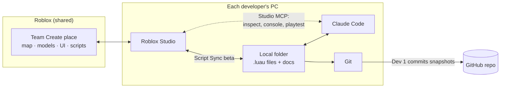
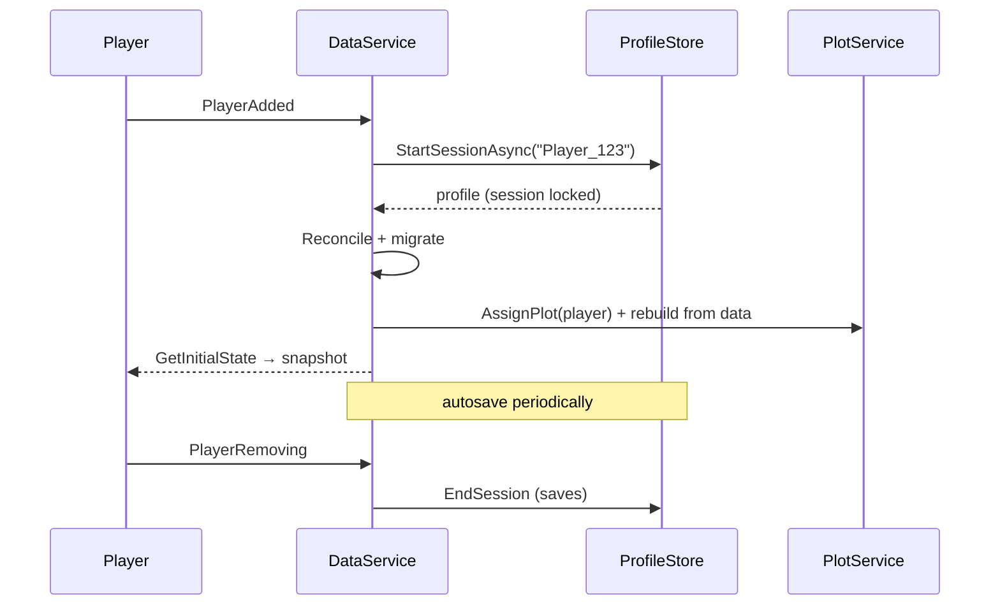
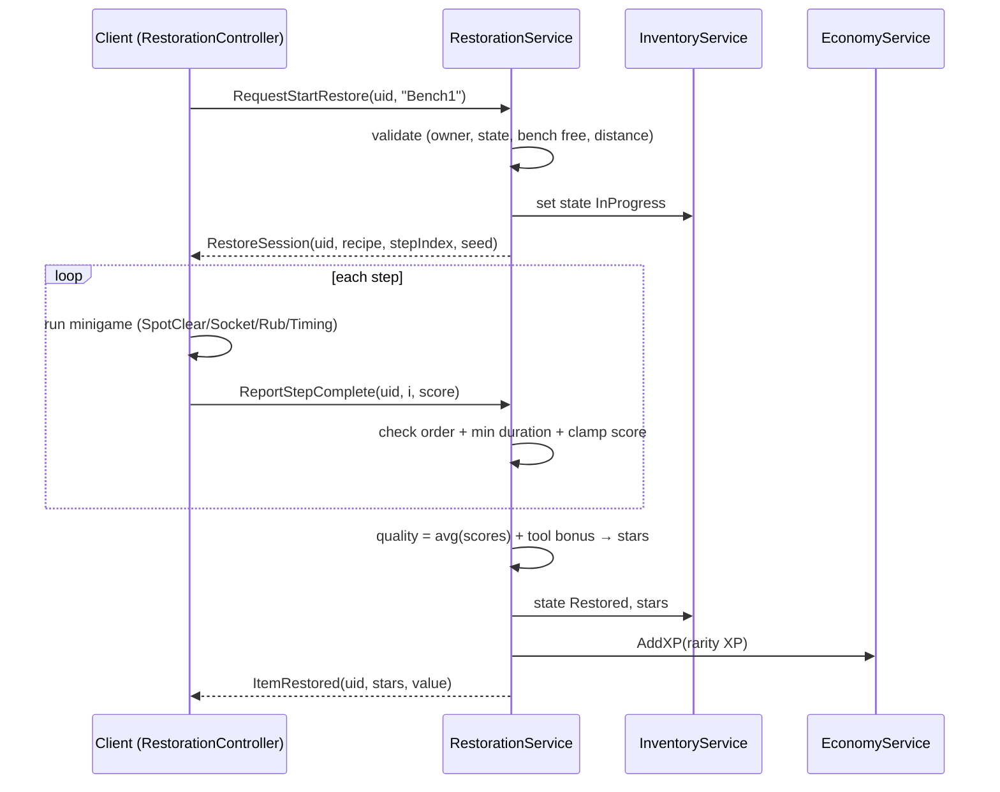

# 03: Technical Architecture

Beginner-friendly, modular Luau. No frameworks. One approved library: **ProfileStore** (saving).

---

## 1. Tooling workflow



- **Team Create** = the live shared place. Everyone builds the world and UI there in real time (no merge conflicts on 3D or UI).
- **Script Sync (Studio beta)** syncs our three code folders to `.luau` files on disk so Claude Code can read and edit them. Enable: *File → Beta Features → Script Sync*, then right-click the folder → *Script Sync → Sync with Directory* and pick the **parent** `src` folder (not `src\Server` itself). Script Sync creates `src\<FolderName>` inside the folder you pick; picking the folder itself makes a nested `src\Server\Server`. To re-link, first stop the old sync on that folder.
- **Roblox Studio MCP server (built into Studio)** lets Claude Code inspect the data model, read Output, and start or stop playtests. Enable in *Assistant → Manage MCP Servers*. Claude Code has a quick-connect option.
- **Git + GitHub** = history and backup of code and docs. **Dev 1 commits a snapshot at the end of each work session** (others don't commit code; this avoids Git conflicts because Team Create already shares live code). Docs changes can be committed by anyone.
- **Ownership rule:** you only edit files you own (see `04_Team_Roadmap_MVP.md`). Two people editing the same script at once in Team Create + Script Sync can overwrite each other. Shared contract files are edited only by their owner after a quick message in the team chat.
- **Fallback if Script Sync misbehaves:** Rojo + Git with each dev's own local place (see `06_Decisions.md` D1).

Disk layout (one folder per synced Studio folder):
```
restore/                         ← Git repo root
├── CLAUDE.md
├── docs/  (01…06, STATUS.md, CHANGELOG.md)
├── tools/econ_sim.py
└── src/
    ├── Server/   ↔ ServerScriptService.Server
    ├── Shared/   ↔ ReplicatedStorage.Shared
    └── Client/   ↔ StarterPlayer.StarterPlayerScripts.Client
```

---

## 2. Studio folder structure

```
Workspace
├── Plots/                       -- Folder: 6 plot Models (Plot1..Plot6), built in Studio
│   └── Plot1/                   -- Model, PrimaryPart = Floor (40x40 studs). Plot1 is the master; Plot2-6 are copies
│       ├── Floor (Part), Walls/, Shelves/  -- greybox geometry, not used by code
│       ├── Spawn (Part)         -- invisible, NOT a SpawnLocation; owner is teleported here / visit point
│       ├── Sign (Part) → SurfaceGui → OwnerName (TextLabel, default "For Sale")
│       ├── Counter (Part) → CheckoutPrompt, QuickSellPrompt, LikePrompt (ProximityPrompts)
│       ├── Benches/Bench1 (Part) → ItemAnchor (Part), CameraPoint (Part, faces the anchor), Prompt
│       ├── DisplaySlots/Slot1..Slot12 (Part + attributes SlotIndex, Enabled; 1-3 Enabled at start. While holding an item the server also sets ItemId (string), Golden (bool), Stars (number), so visitors can draw it)
│       ├── ExhibitSlots/Exhibit1..Exhibit4 (Part + attributes SlotIndex, Enabled; 1 Enabled at start; same ItemId / Golden / Stars attributes while holding an item)
│       ├── DecorSlots/<DecorId> (Model + attribute DecorId; parts Transparency 1 + CanCollide false until bought)
│       │                        -- PottedPlant1, PottedPlant2, Rug, WallPosters, PendantLamps, NeonSign
│       ├── DeliveryPoint (Part)  -- where boxes appear
│       ├── SupplyBoard (Part) → Prompt
│       └── CustomerPath/ (Door, Browse1..3, CounterSpot, Exit: invisible marker Parts)
├── Street (Part)                -- in front of the plots; default SpawnLocation sits on it
└── scenery…

ServerStorage
├── Expansions/BackRoom, Showroom      -- cloned into a plot when bought. Authored in PLOT-LOCAL coordinates (plot Floor centre = origin, WorldPivot (0,0.5,0)); children Benches/<Bench2> and DecorSlots/<model> are moved into the plot's own folders; everything carries attribute ExpansionOf. PlotService opens the BackWall (restyle only) while a room exists
└── NPCs/Kid, Grandpa, Collector, Teen   -- built (greybox R15 rigs, PrimaryPart = HumanoidRootPart, unanchored,
                                          --   name hidden, attribute CustomerType, "Hat" part welded to Head);
                                          --   names = Config/Customers `model`; code sets WalkSpeed from Config

ReplicatedStorage
├── Shared/                       -- synced code (see §3)
├── Assets/
│   ├── Items/<ItemId>            -- item models (Item Model Contract)
│   ├── Boxes/Box, CrateStarter, CrateFlea   -- greybox Models, PrimaryPart = Body (built); names = Crates.boxModel
│   ├── VFX/ (RarityBurst, Bubbles, Sparkle, RustFlakes)
│   └── Sounds/
└── Remotes/                      -- created at runtime by Shared/Remotes.luau

ServerScriptService
├── Server/                       -- synced code (see §3)
└── Packages/ProfileStore         -- library ModuleScript (not synced, never edited)

StarterPlayer/StarterPlayerScripts
└── Client/                       -- synced code (see §3)

StarterGui                        -- built by hand in Studio by Dev 3 (UI contract §8)
├── HUD, Inventory, Discovery, Restoration, Upgrades, Supply, Collection, Settings, Toasts
```

---

## 3. Code folders

```
src/Shared/                                  (ReplicatedStorage.Shared)
├── Config/
│   ├── Items.luau          -- item definitions (§10.1)
│   ├── Rarities.luau       -- colors, XP, bonuses
│   ├── Crates.luau         -- price, unlock, odds, pool
│   ├── Upgrades.luau       -- tools, shop, decor, expansions (§10.3)
│   ├── Customers.luau      -- customer types (§10.2)
│   └── Economy.luau        -- global numbers (start cash, intervals, multipliers, XP curve)
├── Remotes.luau            -- declares + creates/gets every remote (§6)
├── Types.luau              -- type definitions (ItemInstance, PlayerData…)
├── Tutorial.luau           -- [Dev 3] tutorial steps + IsStepDone/CurrentStep from saved data (client shows, server checks)
├── Formulas.luau           -- pure functions: sellPrice(), qualityStars(), xpToNext(), rating() (used by server AND UI previews)
└── Util/
    ├── Signal.luau         -- tiny event helper (optional)
    └── Format.luau         -- "$1.2K", time strings

src/Server/                                  (ServerScriptService.Server)
├── Main.server.luau        -- requires services, calls Init() then Start()
├── Services/
│   ├── DataService.luau         [Dev 1] ProfileStore load/save, get/set helpers, pushes StateChanged
│   ├── PlotService.luau         [Dev 1] assign/release plots, rebuild plot from data, owner checks
│   ├── EconomyService.luau      [Dev 1] add/spend cash, XP & level-ups, rewards
│   ├── InventoryService.luau    [Dev 1] add/remove/move items, capacity, state changes
│   ├── ShipmentService.luau     [Dev 1] free delivery timer, crate purchase, rolls, opening
│   ├── RestorationService.luau  [Dev 1 rules, agreed with Dev 2] start/step/finish validation, quality calc, session ids, failed-save handling (docs/Restoration_Contract.md)
│   ├── DisplayService.luau      [Dev 1 server rules, Dev 3 visuals] display & exhibit slots, slot attributes, reservations for customers
│   ├── CustomerService.luau     [Dev 1] customer DECISIONS: arrivals, type/wish, ChooseItem (reserve), Checkout, Leave
│   ├── CustomerNpcService.luau  [Dev 3] customer BODIES: model from ServerStorage.NPCs, walk Door→Browse→shelf→
│   │                                    counter queue→Exit, Counter.CheckoutPrompt (owner only), 8 s auto checkout;
│   │                                    registers CustomerService.SetSpawnHandler/SetRemovedHandler. Model attributes:
│   │                                    CustomerId, CustomerType, Wish, OwnerUserId, ItemId (once chosen)
│   ├── UpgradeService.luau      [Dev 1] purchase validation, apply effects, expansions & decor
│   ├── CollectionBookService.luau [Dev 1] found/stars/golden tracking, page rewards
│   ├── TutorialService.luau     [Dev 3] RequestTutorialStep: saves tutorial.step / tutorial.done after checking the step against saved data (Shared.Tutorial)
│   └── ShopSocialService.luau     [Dev 3] visits (RequestVisit -> character to the plot's Spawn; refused while restoring); likes (Counter.LikePrompt Triggered on the server: not own shop, 1 per shop per UTC day, owner +1 like, cash capped per day; prompt ObjectText "❤️ N likes"); invites are client only (VisitController, SocialService:PromptGameInvite)
└── Lib/
    ├── Validate.luau       -- type checks, rate limiter, distance check
    └── Log.luau            -- tagged debug printing

src/Client/                                  (StarterPlayerScripts.Client)
├── Main.local.luau         -- LocalScript; requires controllers, Init() then Start()
├── ClientState.luau        -- local mirror of my data; fires Changed signals
├── Controllers/
│   ├── HudController.luau          [Dev 3]
│   ├── InventoryController.luau    [Dev 3]
│   ├── DisplayController.luau      [Dev 3] shelf/pedestal prompts (my plot) + item visuals on every plot from slot attributes
│   ├── DiscoveryController.luau    [Dev 3 UI, Dev 2 VFX]
│   ├── RestorationController.luau  [Dev 2] bench view, camera, step runner
│   ├── RestorationUIController.luau [Dev 3] Restoration screen only: chips/hint/progress/Exit/finish card from RestoreSession, item.stepIndex, ItemRestored
│   ├── ShopController.luau         [Dev 3] upgrades + supply board UI
│   ├── CollectionController.luau   [Dev 3]
│   ├── CustomerUIController.luau   [Dev 3] wish bubbles over customers (BillboardGui "WishBubble" in PlayerGui: wish, then chosen item), hides Checkout prompt from visitors
│   ├── SettingsController.luau     [Dev 3]
│   ├── VisitController.luau        [Dev 3] 👥 Visit window: players on this server, Visit / Go home (RequestVisit) + hides Counter.LikePrompt where a like cannot work
│   └── TutorialController.luau     [Dev 3] tutorial hint + ▼ arrow from Shared.Tutorial; Skip; finish glow on HUD Upgrades
└── Minigames/                      [Dev 2]
    ├── PointerInput.luau   -- unified mouse/touch → raycast hits
    ├── SpotClear.luau      -- Wipe + Scrape
    ├── Socket.luau         -- Reassemble + Replace
    ├── Rub.luau            -- Polish
    └── Timing.luau         -- Test
```

`CollectionBookService` and `ShopSocialService` are named that way so they never get confused with Roblox's built-in `CollectionService` and `SocialService`.

---

## 4. Service pattern

```lua
-- Services/ExampleService.luau
-- Purpose: <one line>.  Owner: Dev X.  Depends on: DataService, EconomyService.
local ExampleService = {}
local DEBUG = false

local DataService, EconomyService -- filled in Init

function ExampleService.Init(services)
    DataService = services.DataService
    EconomyService = services.EconomyService
end

function ExampleService.Start()
    local Remotes = require(game.ReplicatedStorage.Shared.Remotes)
    Remotes.RequestDoThing.OnServerEvent:Connect(function(player, arg)
        -- 1. validate  2. act through other services  3. state updates are pushed by DataService
    end)
end

return ExampleService
```

`Main.server.luau` loads in this order and passes a `services` table to every `Init`:
`Data → Plot → Economy → Inventory → CollectionBook → Shipment → Restoration → Display → Customer → Upgrade → ShopSocial`.

---

## 5. Server vs client responsibilities

| Must be **server-authoritative** (exploit-sensitive) | **Client** responsibilities |
|---|---|
| Cash, XP, level | Input (mouse/touch), camera, bench view |
| All random rolls (crates, golden, spots enabled per item*) | Minigame visuals, particles, sounds |
| Inventory contents and item states | UI screens, animations, tweens |
| Restoration step order, timing checks, final quality | Reveal animation for a server-decided result |
| Prices, sales, tips, wish bonus | Thought-bubble rendering |
| Upgrade/expansion purchases and effects | Local preview of prices (via `Formulas`) |
| Customer spawning, item choice, purchase | Tutorial arrows and hints |
| Plot ownership and who can use prompts | Settings (music/SFX), stored on server too |
| Saving | |

\*Which dirt spots are enabled can be chosen on the client; it is cosmetic.

**Accepted risk:** minigame performance (step scores) is reported by the client. An exploiter could always report 100.
That's acceptable because it only affects their own non-competitive progress. We still cap it: minimum step
durations, max score 100, quality bonus capped by owned tools, and rate limits stop "instant restoration" farming.

---

## 6. Remotes (single source: `Shared/Remotes.luau`)

### Client → Server (RemoteEvents)
| Remote | Args | Owner | Server validates |
|---|---|---|---|
| `RequestOpenBox` | `uid: string` | Dev 1 | item is mine, state `Unopened`, capacity |
| `RequestBuyCrate` | `crateId: string` | Dev 1 | crate exists, level, cash, max 3 unopened boxes waiting, **player within `Economy.SupplyMaxStuds` of `Environment.Districts.Warehouse.SupplyCounter`** (crates are sold only at the Warehouse) |
| `RequestClaimFreeDelivery` | — | Dev 1 | timer elapsed, near DeliveryPoint |
| `RequestStartRestore` | `uid, benchName` | Dev 2 | item mine & `Dirty`/`InProgress`, bench in my plot, free, near bench |
| `ReportStepComplete` | `uid, stepIndex, score, sessionId` | Dev 2 | active session (id matches), correct step, min duration passed, score number 0–100 |
| `RequestExitRestore` | `uid` | Dev 2 | active session (progress kept) |
| `RequestPlaceDisplay` | `uid, slotIndex` | Dev 1 (server), Dev 3 (UI) | item mine & `Restored`, slot unlocked & empty, within InteractMaxStuds of the slot, rate limit 4/s |
| `RequestPlaceExhibit` | `uid, slotIndex` | Dev 1 (server), Dev 3 (UI) | same, exhibit slot |
| `RequestRemoveFromSlot` | `kind, slotIndex` | Dev 1 (server), Dev 3 (UI) | slot mine, not reserved by a customer, capacity (kind is "Display" or "Exhibit") |
| `RequestCheckout` | — | Dev 3 | a customer waiting at my counter, near counter |
| `RequestQuickSell` | `uid` | Dev 1 | item mine & `Restored`, near counter |
| `RequestDisposeItems` | `{ uid, ... }` (max `Economy.DisposeMaxPerRequest`) | Dev 1 | each item mine & `Dirty` (never InProgress/Restored); pays `Formulas.disposePrice` = `Economy.DisposeFraction` (40%) of est. value at 2★, min $1; rate-limited; bad uids skipped; one `Notify "Sale"` toast |
| `RequestBuyUpgrade` | `upgradeId` | Dev 1 | exists, next level, level req, **`requires` owned**, cash |
| `RequestLikeShop` | `ownerUserId` | Dev 3 | **Unused for now (2026-11-16):** likes come from `Counter.LikePrompt` Triggered on the server (Roblox checks the distance). Same rules: not own shop, not liked today |
| `RequestVisit` | `ownerUserId` | Dev 3 | target in server; teleports character to plot Spawn |
| `RequestSaveSettings` | `settings: table` | Dev 1 (server), Dev 3 (screen) | known keys (`music`, `sfx`, `reduceEffects`, `announcements`), booleans only, all-or-nothing, rate limit 2/s |
| `RequestTutorialStep` | `stepId` | Dev 3 | known id (a `Shared.Tutorial` step id, "done" or "skip"); order = the step must already be true in saved data ("done" = all steps); rate limit 2/s |
| `RequestGiveChange` | `amount` | Dev 1 | integer 0..Economy.CashierMaxChange; an open till (CashierService) for this player; near own Counter (InteractMaxStuds + 4); rate limit 4/s. Right change (paid - due) completes the sale via CustomerService.Checkout (first try = checkout bonus); wrong = attempts + 1, CashierUpdate "wrong" |
| `RequestCloseCashier` | — | Dev 1 | closes the player's own till only; rate limit 4/s |
| `RequestTravel` | `placeId` | Dev 1 | known id in Config.Travel (string ≤ 32); 4 s cooldown; alive, not seated, no restoration session; rate limit 2/s; server picks the landing spot |

### Server → Client (RemoteEvents)
| Remote | Payload | Purpose |
|---|---|---|
| `StateChanged` | `path: string, value: any` | Update ClientState (e.g. `"cash"`, `"inventory.<uid>"`, `"upgrades.CleaningBrush"`) |
| `StateChanged("rating", stars)` | `number` 1-5 | Derived, not saved. In the first `GetInitialState` snapshot as `rating`, then pushed when upgrades or exhibits change |
| `Notify` | `kind, text` | Toasts and banners. Kinds: `LevelUp`, `Upgrade`, `Delivery` ("Crate delivered!", "Free delivery arrived!"), `Info` |
| `BoxOpened` | `uid, itemId, isGolden, isNew` | Play reveal |
| `RestoreSession` | `uid, recipe, stepIndex, enabledSpotsSeed, sessionId` | Begin/resume bench view |
| `ItemRestored` | `uid, stars, value` | RESTORED! card |
| `SaleMade` | `amount, wishMatched, tip` | Coins and `+$` popup |
| `Announcement` | `text, rarity` | Server-wide rare find (also posted via TextChatService) |
| `CashierUpdate` | `{state, due, paid, item, attempts, bills}` | The till: state "open" (show bill + payment), "wrong", "done", "closed" |

### RemoteFunction
| Remote | Returns |
|---|---|
| `GetInitialState` | full PlayerData snapshot (once, after the profile loads) |

**Rate limit:** every handler goes through `Validate.rateLimit(player, remoteName, maxPerSecond)` (default 5/s; `ReportStepComplete` 2/s).

---

## 7. Server-side validation checklist (copy into every handler)
```lua
-- 1. Rate limit
if not Validate.rateLimit(player, "RequestBuyCrate", 3) then return end
-- 2. Types
if typeof(crateId) ~= "string" then return end
-- 3. Exists in config
local crate = Crates[crateId]; if not crate then return end
-- 4. Player state (profile loaded, level, ownership, item state)
local data = DataService.Get(player); if not data then return end
-- 5. Distance (character near the relevant part), when the action is physical
-- 6. Affordability / capacity
-- 7. Do it through the owning service (EconomyService.Spend, InventoryService.Add)
-- 8. Never return secrets (no upcoming roll results)
```
Restoration-specific: each step type has a **minimum duration** (Wipe 3 s, Scrape 4 s, Reassemble 3 s, Replace 3 s, Polish 4 s, Test 1 s). Reports faster than that are rejected and logged.

---

## 8. UI contract (Dev 3 owns)
Controllers find UI by fixed names. Changing a name = update this list + tell the team.
```
HUD.MoneyPill.Amount (TextLabel)        HUD.RatingPill.Stars (Frame) → Star1..Star5 (TextLabel "★", color = filled/empty)
HUD.LeftButtons.{Inventory,Upgrades,Collection,Supply} (ImageButton, emoji child "Icon" until real icons)
  -- a ROW under the XP bar (not a column): the bottom-left corner belongs to the phone thumbstick
HUD.TopRight.{Settings,Visit} (ImageButton)
HUD.XPBar.{Fill,Level}  -- Fill.Size = UDim2.fromScale(progress, 1); Level = "Lv N" on top
Toasts.Banner (Frame, hidden) → Text (TextLabel)  -- good news: Notify LevelUp/Upgrade + Announcement, 4 s, queued
  -- in Toasts (DisplayOrder 5), not HUD, so it shows above open windows (moved 2026-11-16)
HUD.UIScale  -- HudController sets Scale by screen size
-- HUD v2 (2026-11-25, Figma "Main HUD — Final Proposal"; HudLayoutController, HudKit, NotificationDock, AutoRunController):
--   HUD.LeftButtons / HUD.TopRight are now FULL-SCREEN transparent containers; every button inside is placed by
--   absolute Position (no UIListLayout). Button names + parents are unchanged, so controllers keep finding them.
--   Visible tiles: LeftButtons.{Inventory, Menu(new), Travel, Sprint(phones only)}, TopRight.{Visit, Settings, GamePasses(new, placeholder)}
--   Menu flyout: LeftButtons.MenuPanel + exactly four cells: LeftButtons.{AutoRun(new), Upgrades, EditShop, Collection}
--   Hidden (not deleted): LeftButtons.{Supply, MyShop}: reached from the Travel window (Warehouse / My Shop)
--   HUD.StatusPlate (new: cash, level, stars, XP) replaces MoneyPill / RatingPill / XPBar, which stay but are hidden
--   Button look = Df* child layers (DfFace, DfLip, DfIcon...), built by HudKit.SkinTile; do not name your own children "Df*"
--   PlayerGui.HudTop (new ScreenGui, IgnoreGuiInset): TopChips.{DayChip, InviteChip}, AutoRunPill, NotificationDock, PriorityBanner
--   Notify / Announcement remotes now show in NotificationDock (max 3 toasts, 4 s, merge); old Toasts screen = fallback only
--   Auto Run is client only (no remote): AutoRunController.{Toggle, Set, IsOn, OnChanged}; key R; stops on manual input
StarterGui.ScreenOrientation = LandscapeSensor  -- landscape only (decision 2026-11-16): windows are ~600 px wide
Inventory.Window.Grid (ScrollingFrame) + ItemCard template in ReplicatedStorage.Assets.UI
Inventory.Window.{Title,Capacity,CloseButton,Empty}  Tabs.{All,NeedsRestoring,Restored}
Inventory.Window.Details.{Hint,ItemName,Rarity,Info,Value,QuickSellButton,RestoreButton,PlaceButton}
  -- PlaceButton: only in picker mode (opened from a shelf/pedestal), "Put on shelf" / "Put on pedestal"
Assets.UI.ItemCard (TextButton) → RarityStroke (UIStroke), StateIcon, GoldenTag, ItemName, Stars, Value
Discovery.Card.{RarityBanner,Name,Dots,Value,NewTag,RestoreButton,StoreButton}
Discovery.Card.{GoldenTag,Counter,Hint}  RarityBanner → Text   Dots → Dot1..Dot5   NewTag/GoldenTag → Text
  -- "Name" clashes with Instance.Name: code must use Card:FindFirstChild("Name")
Restoration.{Hint,StepChips,Progress,ExitButton,FinishCard}   (ScreenGui DisplayOrder 4: above windows, below Toasts)
  StepChips → ChipTemplate (hidden TextLabel)   Progress → Fill   FinishCard → Title, ItemName, Stars, Value, DoneButton (+ UIScale)
  -- Dev 2 calls RestorationUIController.SetProgress(0..1) / SetHint(text); Exit calls RestorationController.Exit() if it exists
Upgrades.Window.{Title,Cash,CloseButton,Tabs,List}  Tabs.{Tools,Shop,Decor,Expansions} (= Config `tab`)
Upgrades.UpgradeTemplate (hidden) → Glow (UIStroke), Icon, Title, Dots (→ Dot1..Dot3), Effect, BuyButton
Supply.Window.{Title,Cash,CloseButton,List}   -- Cash: "💰 $N" pill, live (windows cover HUD money on phones)
Supply.CrateTemplate (hidden) → Name, Info, Odds (→ RowTemplate), BuyButton   -- one card per Config crate with price > 0
Collection.Book.{Title,CloseButton,PageLabel,PrevButton,NextButton,Grid}   -- Grid: UIGridLayout 4×3, one page per item tier
Collection.EntryTemplate (hidden) → RarityStroke (UIStroke), Icon, ItemName, Info, GoldenTag
  -- entry: "?"/"???"/rarity (not found) → name + "Found" → best stars → gold stroke + 🌟 (golden found)
Settings.Window.{Title,CloseButton,Toggles}   Settings.ToggleTemplate (hidden) → Label, Switch (TextButton "ON"/"OFF")
Visit.Window.{Title,CloseButton,InviteButton,List,Empty}   Visit.RowTemplate (hidden) → Name, Info, VisitButton
  -- InviteButton: "📨 Invite" → SocialService:PromptGameInvite (client only)
  -- one row per player on the server, you first ("🏠 Your shop" + "Go home"); List = ScrollingFrame + UIListLayout
  -- one row per key, named after it: announcements, music, sfx, reduceEffects (= SettingsService keys)
Tutorial.Hint (Frame, hidden, bottom centre) → Text (TextLabel), SkipButton (TextButton)   -- ScreenGui DisplayOrder 1 (windows cover it)
  -- the ▼ arrow is a BillboardGui "TutorialArrow" made in code (PlayerGui, client only)
Toasts.Container (Frame + UIListLayout, bottom-center)   Toasts.ToastTemplate (Frame, hidden) → Text (TextLabel)
Toasts.UIScale  -- toasts = Notify kinds other than LevelUp/Upgrade (e.g. "Info"), 3 s, max 3 on screen
```

---

## 9. Saving (DataService + ProfileStore)

- Get ProfileStore from its official GitHub/Creator Store page; put it in `ServerScriptService.Packages`.
- One store: `"PlayerData_v1"` in live; **`"PlayerData_DEV"` when `RunService:IsStudio()`**, so testing never touches real players' data.
- Key: `"Player_" .. player.UserId`.
- On join: start session → `Reconcile()` (fills missing fields from the template) → run `migrate(data)` if `data.version` is old → assign plot → send initial state.
- If the session can't start (locked or failed), kick with a friendly message rather than playing with unsaved data.
- On leave and on `game:BindToClose`: end session (ProfileStore saves).
- **Never store Instances** in data; only plain tables, strings, numbers, booleans. Keep keys as strings.
- Studio testing needs the place published and *Game Settings → Security → Enable Studio Access to API Services* on.



---

## 10. Data structures (`Shared/Types.luau` + Config)

### 10.1 Item definition (Config/Items.luau)
```lua
Items.TinRobot = {
    id = "TinRobot",
    name = "Vintage Tin Robot",
    tier = 1,
    rarity = "Epic",
    category = "Toys",
    baseValue = 180,
    model = "TinRobot",            -- ReplicatedStorage.Assets.Items.TinRobot
    flavor = "Wind it up and watch it march!",
    recipe = {
        { type = "Wipe" },
        { type = "Scrape", layers = 3 },
        { type = "Reassemble", parts = { "LeftArm" } },
        { type = "Polish" },
        { type = "Test", style = "Wind", greenZone = 0.25 },
    },
}
```

### 10.2 Customer definition (Config/Customers.luau)
```lua
Customers.Collector = {
    id = "Collector",
    model = "Collector",           -- ServerStorage.NPCs.Collector
    walkSpeed = 10,
    prefersMinRarity = "Rare",     -- picks Rare+ items if any are displayed
    tipBonus = 0.05,
    weight = 15,                   -- spawn weight vs other types
}
```

### 10.3 Upgrade definition (Config/Upgrades.luau)
```lua
Upgrades.CleaningBrush = {
    id = "CleaningBrush", name = "Cleaning Brush", tab = "Tools",
    maxLevel = 3,
    costs = { 150, 1500, 8000 },
    requiredLevel = { 1, 5, 10 },
    effect = { wipeSpeedMult = { 1.25, 1.5, 1.75 } },   -- index = owned level
    description = "Scrub %d%% faster",
}
Upgrades.BackRoom = {
    id = "BackRoom", name = "Back Room", tab = "Expansions",
    maxLevel = 1, costs = { 2500 }, requiredLevel = { 4 },
    effect = { expansion = "BackRoom", ratingPoints = 3, benches = 1 },
}
```

Optional field `requires = "<upgradeId>"` (e.g. Fish Tank requires `"BackRoom"`, Fountain requires `"Showroom"`): the player must already own that upgrade (`upgrades[requires] >= 1`) **in addition to** meeting `requiredLevel`. `UpgradeService` must validate both. `requiredLevel` alone is not enough: decor unlocks at level 1, so only `requires` stops the Fountain being bought before the Showroom.

### 10.4 Item instance (owned by a player)
```lua
export type ItemInstance = {
    uid: string,
    itemId: string,
    golden: boolean,
    state: "Unopened" | "Dirty" | "InProgress" | "Restored" | "Displayed" | "Exhibited",
    stepIndex: number,       -- next step to do (1-based)
    stepScores: { number },
    stars: number?,          -- 1-3 once restored
    slot: number?,           -- display/exhibit slot index
    acquiredAt: number,      -- os.time()
    crateId: string?,        -- crate it came from (ShipmentService), e.g. "Starter", "FreeDelivery"
    boxId: string?,          -- groups the items of one crate purchase = one waiting box (max Economy.MaxWaitingBoxes)
}
```

### 10.5 Player data template
```lua
local TEMPLATE = {
    version = 1,
    cash = 100,
    xp = 0,
    level = 1,
    inventory = {},          -- [uid] = ItemInstance
    upgrades = {},           -- [upgradeId] = level owned
    collection = {},         -- [itemId] = { found = true, bestStars = 3, golden = false }
    likes = { received = 0, givenToday = {}, rewardedToday = 0, day = 0 },
    stats = { restored = 0, sold = 0, earned = 0, playSeconds = 0 },
    timers = { lastFreeDelivery = 0 },
    tutorial = { step = 0, done = false },
    settings = { music = true, sfx = true, reduceEffects = false, announcements = true },
}
```

---

## 11. Restoration data flow



---

## 12. Performance & mobile
- Keep `Workspace.StreamingEnabled` on (default for new places); make sure each plot's important parts are near the plot (persistent model streaming only if needed).
- Item models: ≤ 60 parts each, anchored, `CanCollide` off for decorative bits. Reuse textures.
- NPCs: ≤ 3 per plot, simple R15 rigs, no per-frame server loops. Use `MoveTo` + `MoveToFinished`.
- Particles: short bursts; respect `settings.reduceEffects`.
- No `while true do` loops without `task.wait()`; prefer events. One heartbeat loop per system at most.
- UI: `UIScale` by screen size; ProximityPrompts (built-in touch support) for world interactions.
