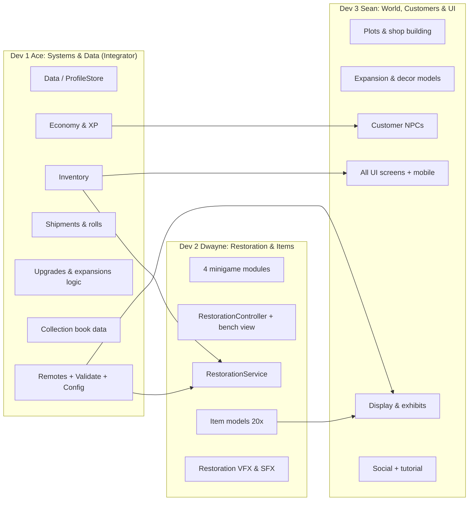
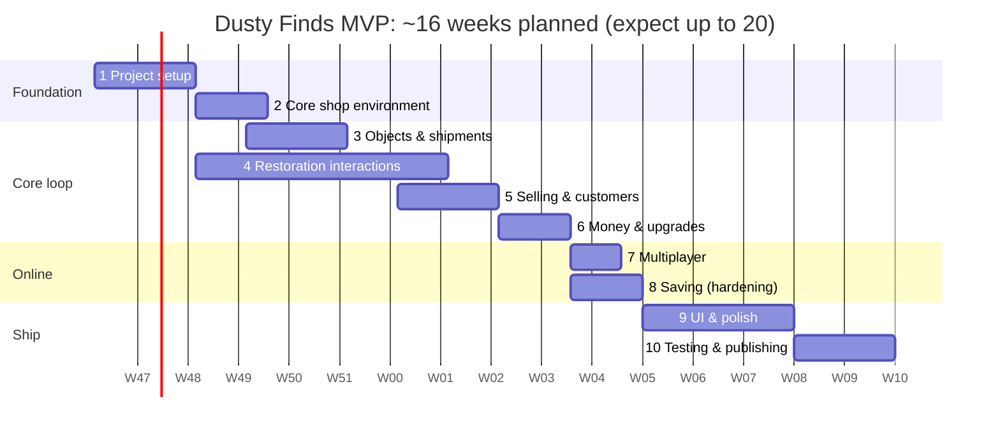

# 04: Team Structure, Roadmap, MVP Scope

Assumption: each developer works **~8–10 hours per week** (students). Estimates include learning time and
debugging AI-generated code. **Claude Code speeds up writing code; it does not remove testing, fixing, building
models, or making UI.**

---

## G. Three-Person Development Structure

### Dev 1: Ace, Systems & Data Lead (and Integrator)
- **Responsibilities:** everything about player data and money; the shared contracts; weekly integration; Git snapshots.
- **Systems:** DataService, PlotService (assignment/rebuild), EconomyService, InventoryService, ShipmentService, UpgradeService, CollectionBookService, `Shared/Remotes`, `Shared/Config/*`, `Shared/Types`, `Shared/Formulas`, `Server/Lib/Validate`.
- **Depends on:** Dev 3's plot model (part names), Dev 2's recipe format.
- **Deliverables:** working data layer by end of Stage 3; crates and inventory by Stage 3; upgrades by Stage 6; saving hardened by Stage 8; economy sim kept in sync.
- **Integration:** owns the contract files. Others request remote/config changes by message; Dev 1 adds them the same day.

### Dev 2: Dwayne, Restoration & Items Lead
- **Responsibilities:** the core fun. Everything that happens at the workbench, plus item models.
- **Systems:** `Minigames/*` (PointerInput, SpotClear, Socket, Rub, Timing), RestorationController (bench view, step runner, finish card logic), RestorationService (server validation and quality), Item Model Contract, 20 item models, restoration VFX/SFX, discovery reveal VFX.
- **Depends on:** InventoryService API (Dev 1), Restoration UI frames (Dev 3 builds the frames, Dev 2 drives them).
- **Deliverables:** Wipe prototype on a baseplate by week 3; all 4 modules by Stage 4; 12 Tier-1 items by Stage 5; 8 Tier-2 items by Stage 7.
- **Integration:** starts in an **isolated test place** (no dependency on others) and merges into the main place once the Item Model Contract is stable.

### Dev 3: Sean, World, Customers & UI Lead
- **Responsibilities:** what players see and walk around in, the customers, and every screen.
- **Systems:** 6 plots + street, expansions and decor models, DisplayService, CustomerNpcService (NPC models, walking, checkout prompt; agreed 2026-11-16: Ace owns CustomerService's decision rules, Sean's CustomerNpcService reacts to it), CustomerUIController, all UI (HUD, Inventory, Discovery, Upgrades, Supply, Collection, Settings, Toasts), TutorialController, ShopSocialService (likes, announcements, visit, invite), mobile layout.
- **Depends on:** Dev 1 for data (ClientState and remotes), Dev 2 for item models on shelves.
- **Deliverables:** greybox plot by Stage 2; display + customers by Stage 5; all MVP UI by Stage 9.
- **Integration:** owns the **UI contract** (`03_Architecture.md` §8) and plot part names.

### How we avoid breaking each other's work
1. **File ownership:** you edit only your files. Need a change elsewhere? Message the owner.
2. **Contracts first:** Remotes list, Config schema, Types, Item Model Contract, UI contract, and plot part names are agreed in Stage 1 and changed only by their owner.
3. **Build behind stubs:** if a dependency isn't ready, write a fake (e.g. Dev 3 uses a fake `ClientState` with test data to build Inventory UI).
4. **Weekly integration playtest (1 hour, same day each week):** all three play the latest build together, file bugs, agree on next week's tasks.
5. **`docs/STATUS.md`** updated after every feature: Done / In progress / Broken / Next.
6. **Everyone learns the whole flow:** each dev explains their system to the others once per stage (10 minutes). Ask Claude Code to "explain how X works with a diagram."

---

## H. Development Roadmap

*Dates are an example starting the week of Nov 23; shift as needed. Stages overlap because the three devs work in parallel.*

### Stage 1: Project setup (2 weeks)
- **Objectives:** tools working for all three; contracts agreed; everyone can make a script and see it run.
- **Required:** Roblox group owns the place; Team Create; Script Sync; Git repo with `CLAUDE.md` + docs; Claude Code + Studio MCP connected on each PC; ProfileStore added; empty `Main` scripts and folder structure; contracts written (Remotes list, Types, Item Model Contract, UI contract, plot part names). Each dev completes Roblox's beginner scripting tutorials.
- **Dependencies:** none.
- **Done when:** each dev asks Claude Code to create a test script, and it prints in Studio Output via Script Sync; MCP can start a playtest; first Git commit exists.
- **Mistakes to avoid:** skipping contracts ("we'll figure it out later"); everyone syncing the same folders and editing the same file; publishing to a personal account instead of a group.

### Stage 2: Core shop environment (1.5 weeks)
- **Objectives:** a greybox shop you can walk around, ×6 plots on a street.
- **Required:** Plot model with all named parts (`03_Architecture.md` §2); PlotService assigns a plot on join and puts the owner's name on the sign; spawning at your plot.
- **Dependencies:** Stage 1 contracts.
- **Done when:** 3 players in *Start Server* each get their own plot with their name; leaving frees the plot.
- **Mistakes:** making it pretty now (greybox first; art in Stage 9); unanchored parts; plots too big for mobile walking.

### Stage 3: Objects & shipment system (2 weeks)
- **Objectives:** get items: free delivery + Starter crate → boxes → open → item in inventory.
- **Required:** Config Items/Rarities/Crates (Tier 1); InventoryService; ShipmentService; EconomyService (cash only); **DataService with ProfileStore in DEV store** (start saving early; retrofitting later is painful); basic debug inventory list UI; box model at DeliveryPoint.
- **Dependencies:** Stage 2 plots.
- **Done when:** buy crate → cash drops → 3 boxes appear → open → items listed with correct rarities; odds over 1,000 test rolls (via a debug command) roughly match config; rejoining keeps items (Studio API access on).
- **Mistakes:** rolling on the client; storing Instances in data; not handling full inventory.

### Stage 4: Restoration interactions (4–5 weeks, starts during Stage 2)
- **Objectives:** the core fun works and feels good.
- **Required:** PointerInput; SpotClear (Wipe → Scrape); Socket; Rub; Timing; bench view camera; RestorationController step runner; RestorationService validation and quality; 4 Common items + Tin Robot as a showcase; basic sounds and particles.
- **Order:** Wipe on one item in a test place → bench camera → Polish → Socket → Timing → Scrape → server validation → integrate with inventory.
- **Dependencies:** Inventory API (Stage 3) only for the final integration step.
- **Done when:** a Dirty item from inventory can be restored at the bench with mouse **and** touch; quality stars appear; leaving mid-way keeps progress; server rejects a too-fast step report.
- **Mistakes:** building all 6 interactions before one feels good; complex 3D rotation; forgetting touch input; trusting client-side completion with no minimum time.

### Stage 5: Selling & customer system (2 weeks)
- **Objectives:** turn restored items into money.
- **Required:** DisplayService (place/remove, reservations); CustomerService [Dev 1: decisions] + CustomerNpcService [Dev 3: spawn, waypoint walk, counter, auto-checkout] (see docs/Customer_Server.md); Quick Sell; SaleMade feedback; 4 NPC looks.
- **Dependencies:** Stages 3–4.
- **Done when:** put 3 items on shelves → customers come in, show wishes, buy, pay correct price (verify against `Formulas.sellPrice`); 2 players' shops run customers at the same time without errors.
- **Mistakes:** PathfindingService (not needed); server loops per NPC per frame; customers buying an item that was just removed (use reservations).

### Stage 6: Money & upgrade system (1.5 weeks)
- **Objectives:** spend money for visible progress.
- **Required:** XP + levels; UpgradeService with all MVP upgrades; decor slots appear; Back Room + Showroom expansions cloned in; rating calculation; effects wired (brush speed etc.); Tier 2 crate unlock at Lv 5.
- **Dependencies:** Stages 3–5.
- **Done when:** every upgrade in `02_Economy.md` can be bought once its requirements are met, its effect is noticeable, and it persists after rejoin.
- **Mistakes:** hardcoding costs; applying effects only on purchase but not on rejoin (rebuild from data!).

### Stage 7: Multiplayer (1 week)
- **Objectives:** social layer.
- **Required:** visitors can't use others' prompts; Visit list; Like shop (daily cap); rare-find announcements; invite button.
- **Dependencies:** Stages 2, 5.
- **Done when:** with 3 test players: visiting works, a visitor can't touch anything, likes cap correctly, Legendary find announces to all.
- **Mistakes:** forgetting owner checks on *every* prompt; announcement spam (Epic+ only).

### Stage 8: Saving & loading, hardening (1.5 weeks; basic saving already exists since Stage 3)
- **Objectives:** never lose or duplicate progress.
- **Required:** data versioning + `migrate()`; BindToClose; session-lock failure handling; plot rebuilt fully from data; settings saved; switch to live store name for publishing.
- **Done when:** all data tests in `05_Monetization_QA.md` §L2 pass.
- **Mistakes:** testing only in Studio solo; using live store in Studio; changing the template without a version bump.

### Stage 9: UI & polish (3 weeks)
- **Objectives:** feels like a real game.
- **Required:** final HUD and all screens (J3), tutorial (first 2 minutes), sounds/music, rarity VFX, art pass on shop and street, Tier 2 item models, mobile layout pass, settings.
- **Done when:** a new tester completes the tutorial without help on PC and phone; no placeholder UI left.
- **Mistakes:** UI that only fits 16:9 PC; too many modals; polishing features that aren't in the MVP.

### Stage 10: Testing & publishing (2 weeks)
- **Objectives:** stable public release.
- **Required:** full QA checklist; 5+ outside testers; economy tuning pass; icon, thumbnails, description; Maturity & Compliance questionnaire; monetization items (cosmetic only) set up; soft launch to friends, then public.
- **Done when:** release checklist (`05_Monetization_QA.md` §L8) fully ticked.
- **Mistakes:** launching with known data bugs; no way to hear player feedback (add a group wall or Discord link).

**Total: ~16 weeks planned; a buffer to 20 weeks is realistic for first-time developers.**

---

## I. MVP Scope

### I1. Required for launch ✅
- [ ] 6 plots per server, auto-assigned, owner name on sign
- [ ] Free Delivery (3 min) + Starter Crate + Flea Market Crate
- [ ] 20 items (12 Tier 1, 8 Tier 2), 5 rarities, Golden variant
- [ ] 6 interactions via 4 minigame modules; recipes per item; quality stars
- [ ] Inventory with capacity; Quick Sell
- [ ] Display shelves (3 → 12, +6 in Showroom), exhibit pedestals (1 → 4)
- [ ] Customers: 4 looks, wishes, checkout + auto-checkout, tips
- [ ] Upgrades: Brush, Toolkit, Polisher, Shelves, Storage, Sign; 7 decor; Back Room + Showroom
- [ ] XP/levels to 15, shop rating 1–5 stars
- [ ] Collection book with page rewards
- [ ] Social: visit, like (capped), rare-find announcements, invite
- [ ] Saving with ProfileStore; settings
- [ ] Tutorial (first 2 minutes)
- [ ] PC + mobile; sounds and music
- [ ] Cosmetic-only monetization (a few items, `05_Monetization_QA.md` §K)

### I2. Wait for updates ⏳
| Feature | Target |
|---|---|
| Co-op helping on friend's Back Room bench | Update 1 |
| Antique Dealer crate tier + 8 items | Update 1 |
| Haggling with customers | Update 1 |
| Daily free mystery crate / login streak | Update 1 |
| Rotate-item button / more Test styles | Update 1 |
| Estate Sale tier | Update 2 |
| More variants (color, signed, prototype) | Update 2 |
| Seasonal events & themed item sets | Update 2+ |
| Free-placement build mode | Update 3 (big feature) |
| Global leaderboards (most likes, collection %) | Update 2 |

### I3. Do NOT build in the first release 🚫
- **Trading** between players (scams, duplication risk, policy complexity)
- **Anything random that costs Robux**, or cash packs (see `05_Monetization_QA.md`)
- Free-form building/placement
- Pets, rebirth/prestige, quests/story, combat, vehicles
- Custom chat, cross-server features, global marketplace
- Procedural damage/dirt textures, mesh deformation, physics-based repair
- A second currency
- Console-specific UI (later)
