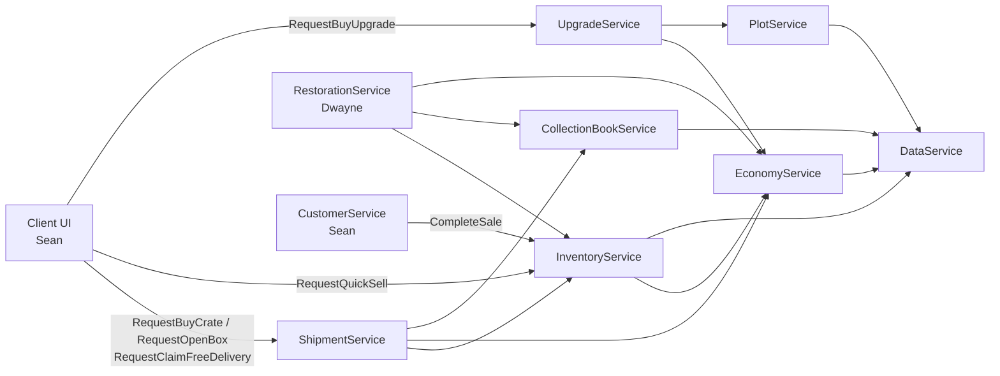

# Core loop (server side) and how to test it

Owner: Dev 1 (Ace). Written for Dwayne and Sean. Source of truth for contracts is still `03_Architecture.md`;
what is built and tested right now is in `STATUS.md`.

## 1. What calls what



**Rule:** nothing outside `DataService` writes player data. Other services call the owner of that data:
cash and XP go through `EconomyService`, items through `InventoryService`, the collection through `CollectionBookService`.

## 2. Item states

`Unopened` (a box, not counted in capacity) -> `Dirty` (opened, needs restoring) -> `InProgress` -> `Restored`
-> `Displayed` (on a shelf, for sale) or `Exhibited` (kept, gives rating points) -> sold (item removed).
Capacity counts every item except Unopened, Displayed and Exhibited.

## 3. Functions you may call (server only)

| Service | Function | Use it for |
|---|---|---|
| EconomyService | `AddCash(player, amount, reason?)`, `Spend(player, amount)`, `CanAfford`, `AddXp(player, amount)` | money and XP. Whole numbers only. `AddXp` handles level-ups and pays $50 x new level. |
| InventoryService | `Add`, `Get`, `Remove`, `Update(player, uid, {state, stepIndex, stepScores, stars, slot})`, `ClearField`, `HasRoom`, `QuickSell`, `CompleteSale` | items. `Update` is all-or-nothing and refuses unknown or locked fields. |
| CollectionBookService | `RecordFound`, `RecordRestored(player, itemId, stars, golden)`, `GetRatingPoints`, `GetRatingStars` | collection book and shop rating |
| ShipmentService | `BuyCrate`, `ClaimFreeDelivery`, `OpenBox`, `GrantFirstBox`, `RollItem` | boxes |
| UpgradeService | `BuyUpgrade(player, upgradeId)` | upgrades (also the remote handler) |
| PlotService | `GetPlot(player)`, `RefreshSlots(player)` | the player's plot; `RefreshSlots` also shows decor |
| Shared `Formulas` | `sellPrice`, `quickSellPrice`, `qualityStars`, `xpToNext`, `ratingStars`, `tipChance`, `tipAmount`, `checkoutBonus`, `customerSpawnInterval` | pure maths, also safe on the client for previews |

Customers (Sean): when a customer buys, call
`InventoryService.CompleteSale(player, uid, {wishMatched = ..., checkout = ..., tipBonus = customer.tipBonus})`.
The item must be `Displayed`. Do not work out prices or tips yourself.

Restoration (Dwayne): when a step finishes call `InventoryService.Update` with the new `stepIndex` and `stepScores`.
When the last step finishes, work out stars with `Formulas.qualityStars(average, toolBonus)`, then
`Update(... {state = "Restored", stars = n})`, `CollectionBookService.RecordRestored`, and
`EconomyService.AddXp(player, Rarities[rarity].xpPerRestore)` (x `Economy.Tier2XpMult` for tier 2).

Decor (Sean): each decor model in `Plot.DecorSlots` is hidden (Transparency 1) and shown when bought. A part can
set attributes `VisibleTransparency` (default 0) and `VisibleCanCollide` (default false) to choose how it looks when shown.
Config decides which slot shows when: `decorSlots` on an upgrade in `Config/Upgrades.luau`.

## 4. Automated tests (run while Playing, in the command bar, Server)

| Test | Command | Expected |
|---|---|---|
| Services, rolls, selling, upgrades | `require(game.ServerScriptService.Server.Tests.SystemsCheck).run()` | `[SystemsCheck] 129 passed, 0 failed` |
| Plots and decor | `require(game.ServerScriptService.Server.Tests.PlotCheck).run()` | `[PlotCheck] 27 passed, 0 failed` |
| DevTools | `require(game.ServerScriptService.Server.Tests.DevToolsCheck).run()` | `[DevToolsCheck] 20 passed, 0 failed` |
| Settings and playtime | `require(game.ServerScriptService.Server.Tests.SettingsCheck).run()` | `[SettingsCheck] 20 passed, 0 failed` |
| Config data (Edit mode) | `require(game.ReplicatedStorage.Shared.Tests.ConfigCheck).run()` | `231+ passed, 0 failed` (prints the count) |
| Formulas (Edit mode) | `require(game.ReplicatedStorage.Shared.Tests.FormulasCheck).run()` | `[FormulasCheck] 117 passed, 0 failed` |

These use fake data and copies of the services, so they never touch your saved test profile.
**Do not** `require` a service from the command bar to call it: you would get a second copy that is not the running one.

## 5. Testing by hand with DevTools (Studio only)

While Playing, in the command bar choose **Server** and run (use your own player):

```lua
local DT = game.ServerStorage.DevTools
local me = game.Players:GetPlayers()[1]
print(DT:Invoke("help"))
DT:Invoke("giveCash", me, 500)
DT:Invoke("setLevel", me, 5)
DT:Invoke("addXp", me, 20)                            -- XP through EconomyService (level-ups work)
DT:Invoke("giveBox", me, "Starter")                  -- 3 Unopened items, open them with RequestOpenBox
DT:Invoke("giveItem", me, "TinRobot", "Restored", 3)  -- itemId, state, stars, golden
DT:Invoke("maxUpgrades", me)                         -- shows all decor, 12 display slots
DT:Invoke("resetProfile", me)                        -- back to a brand-new player
print(DT:Invoke("dump", me))                         -- all saved data
```

`resetProfile` and `maxUpgrades` change your saved test profile (`PlayerData_DEV`). That is what they are for, but
only use them on a profile you do not mind resetting. DevTools does nothing on a live server.

## 6. Manual loop check (about 5 minutes)

1. Play. Output shows `[DataService] profile loaded`, `[PlotService] <you> -> Plot1`, `[ShipmentService] first box` (new profile).
2. From a client script or the UI, fire `RequestOpenBox` with the box uid (find it with `dump`). Expect `BoxOpened`, cash +$10 (first find).
3. `RequestBuyCrate("Starter")`: cash -$50, 3 Unopened items. Open them.
4. `giveItem ... "Restored" 2`, then `RequestQuickSell(uid)`: cash goes up, the item disappears.
5. `RequestBuyUpgrade("Rug")` with $150: cash -$150, the Rug appears on your plot.
6. Stop and Play again: everything is still there.

## 7. Known limits right now

- No UI buttons call the remotes yet, so steps 2 to 5 need a script or DevTools.
- Back Room / Showroom rooms are not cloned when bought (the upgrade and its rating points work).
- A cheating client can see the contents of its own unopened boxes (they are rolled when bought). It only affects that player.
- Customers, displaying items and restoration are Dev 2 / Dev 3 work and are not built yet.
